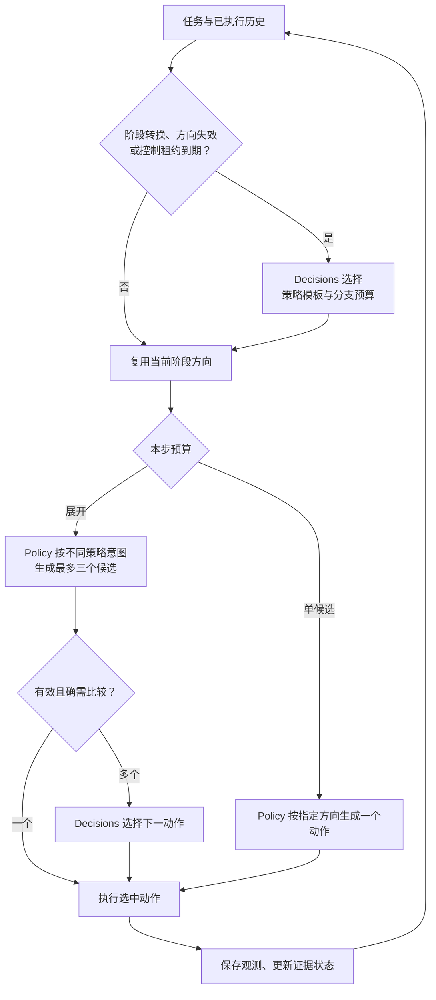

# 从事后筛选到主动监督：轨迹诊断、机制设计与下一轮实验

日期：2026-11-10。范围：只读诊断、方法设计与实验方案。本次未修改生产代码、VM 配置或现有轨迹，未启动推理或新实验。

**建议采用“阶段级 Decisions 控制器＋自适应候选预算＋策略条件化生成”作为下一版 B2。** 常规步骤生成一个动作；只有存在需要比较的诊断或修复方向时才展开候选。控制器按事件触发并短期复用方向，避免每一步增加一次长上下文监督调用。采样后去重保留为补救措施。

## 1. 从 VM 核实了什么

只读来源：`swebench@swebench-pro-v2-runner`，项目 `model-shelter-513813-v8`、区域 `us-central1-a`，目录 `/home/swebench/big-supervise-big-exp/runs/`。

已核对 28 道正式题的 A_r1/A_r2/A_r3/B：逐条读取 `events.jsonl`、`result.json`、`manifest.json` 和 `grading/grade.json`。原抽样配置为 28 正式题＋2 开发题。题号按当前本地 `configs/tasks_30_stratified.json` 的 `tasks` 顺序排除 `dev_tasks` 后编号。

证据文件：

- [AB_轨迹诊断证据.json](AB_轨迹诊断证据.json)：逐题结果、逐角色回执统计、重复命令与版本信息；包含 112 个 A/B 日志文件的 SHA-256。
- [派生指标.json](派生指标.json)：由回执汇总计算的比例与费用。
- [典型轨迹片段.json](典型轨迹片段.json)：第 13、20、21 题的部分已执行动作与实际观测。
- [补丁与评分完整性核验.json](补丁与评分完整性核验.json)：112/112 份实际补丁均与封存 hash 及评分记录的补丁 hash 一致。

### 1.1 成功率与费用

| 口径 | A：三条轨迹合计 | B：主模型生成 | B：Decisions | B：两角色合计 |
| --- | ---: | ---: | ---: | ---: |
| 输入 tokens | 29,638,300 | 27,855,300 | 8,908,519 | 36,763,819 |
| 输出 tokens | 1,054,843 | 925,555 | 0 | 925,555 |
| 有响应的请求数 | 1,233 | 1,182 | 384 | 1,566 |
| 已知 API 费用，USD | 1.19421845 | 0.86652962 | 0.89085190 | 1.75738152 |

A 的 Oracle Pass@3 为 **18/28**，B 的监督 Pass@1 也是 **18/28**，而且成功题集合完全相同。本次数据中没有“A 成功、B 失败”或“B 成功、A 失败”的题。这不证明两种机制普遍等价；A 每条单独成功 17/28，仍有少量重复尝试覆盖收益。

B 的已确认输入比 A 三条轨迹合计多 **24.04%**，已知 API 费用多 **47.16%**。3 次监督器 502 拒答缺失 token/费用回执；表中未把它们记为免费，也未包含 VM 费用。因此 B 的完整支出仍有未知部分。

### 1.2 成本问题不只有“生成了重复分支”

B 的 Policy 输入缓存命中为 26,725,047 / 27,855,300，约 **95.94%**；Decisions 回执汇总未记录缓存命中，这不证明服务底层完全没有缓存。监督器占 B 已知 API 费用的 **50.69%**，费用已经高于全部 Policy 候选生成费用。

因此下一版同时需要：

1. 在生成之前减少不必要的候选数，特别是读取、补丁查看、等待和提交步骤。
2. 减少监督器调用频率，并限制其重复读取长历史的开销。不能把“多加一层 planner”自动当成成本优化。

这里统计的是服务回执中的 token 与缓存字段，未把应用层 `input_token_bound` 估计当成真实 token 数；也不从缓存回执推断模型底层计算量。

### 1.3 重复程度：命令相同与候选相同必须区分

B 共记录 **394 步**，每步均产生了 3 份候选；其中 **382 步三份动作全部有效**，另 12 步包含无效候选。

| 三份有效命令的不同数量 | 步数 | 解释 |
| --- | ---: | --- |
| 1 | 37 | 三个命令相同，约占三份均有效步骤的 9.69% |
| 2 | 50 | 有一份重复命令 |
| 3 | 295 | 命令字符串不同，尚不能据此证明策略不同 |

命令比较使用 `action.strip()`，不随意改写引号、合并 shell 表达式或声明不同 shell 字符串语义等价。

- 按动作去重，382 步中有 **124 个重复生成位置**，占全部 1,182 次 Policy 响应的 10.49%。
- 这 124 个位置对应 4,108,905 输入 token、29,168 输出 token、已知费用 0.057269275 USD。它们分别占 B 总输入约 **11.18%**、已知 API 费用约 **3.26%**。
- 若同时比较可见 thought 与 action，重复位置降为 **41 个**；37 个“三命令相同”步骤里，只有 **9 步**的三个可见 thought 也全部相同。

这些是**事后动作重复统计**。删除某个生成位置后模型后续轨迹可能改变，也可能失去有用的思考文本，因此不能把上述 token/费用直接宣称为新方法已实现的节省。未返回的隐藏推理也不在此比较范围内。

### 1.4 具体轨迹支持的判断

- **第 5 题，B 第 7 步：**三个动作均为 `cd /app && cat patch.txt`，可见 thought 也相同；现有版本已跳过选择器，但仍先完成了三次生成。
- **第 26 题，B 第 10/11 步：**三份分别一致地选择查看补丁、提交补丁；现有日志记录 `unanimous_valid_action_random_choice`，只省掉监督器调用。
- **第 27 题，B 第 12 步：**提交命令及可见 thought 均相同，同样仍发生三次生成。
- **第 20 题，B 第 9 步：**三个命令均为 `cd /app && cat patch.txt`，但可见 thought 不全相同。监督器连续三次返回 502，消息为 `OpenAI refused to answer question "next_action"`，随后 `selector_error`。重复命令与拒答同时发生，但该错误消息没有解释拒答原因，不能据此证明“命令相同导致拒答”。已保存补丁最终独立评分成功，故接口失败不等于修复失败。
- **第 21 题，B 共 50 步：**有 **32 个已执行动作**涉及 `/tmp/vuls-go-test.exit`，其中第 15 步启动后台测试，另外 **31 步是显式轮询**；最后观测显示本地测试通过。这是等待型控制开销的直接例子；它不证明模型在同一个错误根因上打转，也不证明减少轮询即可修复该题的最终失败。证据文件中的 `polling_actions` 按监控文件名筛选，包含该启动动作，不能直接将数组长度视为纯轮询次数。
- **第 13 题：**以 `context_limit` 结束，但已保存补丁独立评分成功。新控制器应保留“退出原因”和“补丁评分”两套字段。

### 1.5 当前 B 不是单一冻结协议

manifest 中存在 3 个代码哈希、2 个配置哈希：

| B 代码哈希 | 题数 |
| --- | ---: |
| `5a7b53e6b1…` | 9 |
| `7b28d647c3…` | 8 |
| `796f7cc2bc…` | 11 |

完整哈希保存在证据文件中，表中只显示前缀。

37 步三命令一致的情况中，11 步有“跳过选择器”的回退记录，25 步仍有监督答案，1 步未形成 selection 记录即异常结束。

目前 C 同时存在历史 alias 与新的独立运行，且独立运行尚未完成。下一轮分析不能将 alias 与独立 C 混成同一种基线。本方案不改动当前 C，也不合并或覆盖其结果。

## 2. 推荐机制：监督器先控制方向和预算

### 2.1 主循环



方向和候选预算在生成之前确定，才有机会省掉额外两次 Policy 调用。后置选择保留在确有多个有效分支的步骤；不是每一步都调用两次监督器。

### 2.2 Decisions 能做什么

Decisions 返回预定义问题的 choice、predicate 或 score，不能要求它像生成模型一样自由撰写任意计划。[OpenAI Docs](https://developers.openai.com/api/docs/guides/decisions)、[OpenRouter Decisions schema](https://openrouter.ai/docs/guides/community/multimodal-decisions)。

本轮主机制使用**离散策略模板选择**。控制器从合法的“策略＋候选数＋租约”组合中选一个 ID，应用程序再映射为 Policy 指令；不把一个任意 JSON 计划对象当作 Decisions 可自由生成的输出。

| 控制选项 | 对主模型的方向约束 | 候选预算 | 默认租约 |
| --- | --- | ---: | ---: |
| `LOCATE_SINGLE` | 找到与当前已知符号/需求相关的证据；目标未知时先定位 | 1 | 最多 3 个动作 |
| `INSPECT_SINGLE` | 沿已确认目标读取必要文件或 diff，避免重复扫描 | 1 | 最多 3 个动作 |
| `DIAGNOSE_PORTFOLIO` | 对比不同根因假设及能区分它们的诊断动作 | 最多 3 | 1 个动作 |
| `EDIT_SINGLE` | 根据已有证据执行当前最可信的最小修复 | 1 | 1 个动作 |
| `EDIT_PORTFOLIO` | 对比不同修复位置、接口处理或兼容性策略 | 最多 3 | 1 个动作 |
| `VERIFY_SINGLE` | 针对已修改行为验证，区分测试失败与环境/工具失败 | 1 | 最多 3 个动作 |
| `WAIT_SINGLE` | 已确认后台进程仍在运行时，采用明确间隔的单候选检查 | 1 | 最多 3 个动作 |
| `FINALIZE_SINGLE` | 检查现有补丁、完成提交；发现问题则撤销该阶段 | 1 | 最多 2 个动作 |
| `REOPEN_ASSUMPTION` | 撤回当前根因假设，先生成一个能反证它的诊断动作 | 1 | 1 个动作 |

租约是方向复用上限，不是无条件允许继续；不能跳过单步预算、超时、动作有效性或终止检查。`FINALIZE_SINGLE` 也不代表宿主自动提交，主模型仍需实际检查并选择提交动作。

### 2.3 真正区分候选的策略意图

`DIAGNOSE_PORTFOLIO` 的候选不再是同一提示换三个 seed，而是在相同已执行前缀上分别追加：

1. **主要假设：**沿当前最可信的根因寻找最直接证据。
2. **反证假设：**寻找能推翻主要假设的输入、分支或调用路径；不是只换一个搜索命令。
3. **边界假设：**检查接口约束、调用方、数据流或兼容性边界是否被遗漏。

`EDIT_PORTFOLIO` 则区分最小局部修复、共同根因位置修复、接口/兼容性修复；前提是当前证据确实支持这些替代方向。没有合理替代方向时选择 `EDIT_SINGLE`，不强行制造三种代码风格。

各候选保留简短、可见的“意图标签＋证据引用＋动作”，不要求隐藏思维链。只有选中的动作和相应可见文本进入后续轨迹。策略提示放在共享历史之后，尽量保留主模型可复用的缓存前缀。

这提供的是**策略条件化生成**，不保证候选一定有语义多样性，也不保证预定义策略库能发现全新的根因。

### 2.4 什么时候重新调用控制器

首步调用一次；随后只在以下事件之一发生时重新选择方向：

- 当前租约到期。
- 文件修改完成、实际测试结果出现、明确进入补丁检查或提交阶段。
- 动作格式错误、命令失败、工具缺失、超时，导致原方向的前提失效。
- 连续 2 个动作没有新增证据、工作树变化或测试状态变化，且没有仍在运行的任务能解释这种等待。
- 重复执行相同“动作＋可比观测”而没有进展，或当前方向与目标显著冲突。

“没有进展”不能仅由返回码判断：搜索无匹配可能是有效反证；后台测试进程持续推进也不是根因停滞。先记录可验证的进程/产物状态，再由控制器判断是否需要重开假设。

第 21 题这类后台测试等待应复用 `WAIT_SINGLE`，而不是为每次轮询生成三种近似命令。本轮主方案仍由 Policy 生成轮询动作；新增宿主级异步 wait 工具属于另一项 runner 优化，暂不混入主机制效果。

### 2.5 控制器看什么

主模型继续读取原有完整可见历史，不在这一步同时引入主模型历史压缩。

新控制器使用固定视图：完整任务说明、当前策略/目标、已修改文件、实际测试状态、最近动作/观测的固定长度视图，以及“当前假设/未验证事项”的可追踪字段。控制器动态状态建议最多约 4K tokens；完整任务说明单独保留，不为凑预算悄悄删除需求。

首版状态优先由执行日志和确定性元数据提取：文件变更、退出码、已知进程、测试命令与完成状态等；不额外雇一个生成模型持续写摘要。无法可靠提取的字段标为未知，不让控制器把摘要猜测当证据。控制器有限视图的误路由必须单列。

后置动作选择器先沿用当前完整共享前缀视图，以便把“选择器历史压缩”留作后续单独消融。控制器视图与动作选择器视图要分别记录，不声称二者信息相同。

### 2.6 去重、拒答与失败边界

- 生成后仍记录 action 去重数及可见 thought/action 去重数，防止把标签多样性冒充语义多样性。
- 命令一致但 thought 不同时，环境转移相同，下一轮模型历史却可能不同。若跳过监督器，必须使用预先冻结的代表选择规则并记录；不能无声地把它当成完整候选等价。为对照方便，可沿用现有 seeded representative 规则，四个新组一致。
- 不反复补采样直到凑齐三个“不同”动作；那会重新制造费用偏差。有效候选不足时如实记录并进入统一的格式/失败流程。
- 监督器拒答不能作为“选第一个”的理由，也不能伪造为普通 502 自动重试已解决。下一轮建议把明确的 refusal 与普通临时 5xx 分开记录；恢复策略四组统一。
- 控制器失效或拒答也要有明确终态，不能偷偷降级为无监督运行后仍算纯 B2。保留当前补丁独立评测。

## 3. 为什么不能每一步简单多加一个 planner

设一个 Policy 候选平均费用为 `Cg`，一次后置选择平均费用为 `Cd`，`q` 为需要展开三候选的步骤比例。

```text
原始三候选每步费用 ≈ 3*Cg + Cd
每步都加控制器的费用 ≈ (1+2q)*Cg + Cpre + q*Cd
```

若控制器与旧选择器同样贵，令 `Cpre=Cd`，则新方法只有在：

```text
q < 2*Cg / (2*Cg + Cd)
```

才比理想化的旧流程便宜。按当前已知回执均值，`Cg≈0.0007331 USD`、`Cd≈0.0023382 USD`，阈值约 **38.5%**。这是静态费用模型，不是下一轮真实节省预测，且已忽略旧组部分去重旁路和轨迹长度变化。

如果控制器以每步平均 `rho` 次调用的频率触发，费用近似为：

```text
每步新费用 ≈ (1+2q)*Cg + rho*Cpre + q*Cd
```

因此主方案同时控制 `q`、`rho` 和控制器输入长度。以 `q=0.25、rho=1/3、Cpre=Cd` 为例，静态模型的费用约下降 46%；只能作为规划情景，不能写成已达到的结果。实际缓存、输出、调用重试和后续步数都必须实测。

不直接使用 Choice 概率的熵或最大值决定候选数。它们既没有在本任务上校准为成功率，也不等于“再生成两个动作的预期收益”。首版直接选择合法 route/budget 组合，再用结果验证门控质量。

## 4. 下一轮实验：将“省调用”与“方向引导”拆开

### 4.1 四个机制组

| 新组 | 事前分支预算门控 | 策略条件化候选 | 用途 |
| --- | --- | --- | --- |
| `B_ref` | 无，固定三个 | 无，同上下文不同 seed | 统一冻结的被动筛选参考 |
| `B_gate` | 有，1 或 3 | 无 | 测试自适应分支预算是否省成本、会否漏掉好候选 |
| `B_direction` | 无，固定三个 | 有，阶段策略控制 | 测试方向约束是否改善候选与解题；完整计入额外控制费用 |
| `B2` | 有 | 有 | 测试两种机制结合后的系统效果 |

四组都使用相同的当前同动作旁路、候选有效性、拒答处理、runner 与 grader；不得给 B2 额外加入自动 patch 改写、人工修补或隐藏测试反馈。策略效果包含其必要的控制调用开销，不称为严格计算量相等的因果比较。

如果实现时统一加入新日志字段或拒答分类，应先将这些不改变选中动作的基础修正应用于四组，再冻结一个源码提交。不能拿现有三个版本混合的 B 直接充当新实验唯一的 `B_ref`。

现有 A、B、C 数据继续保留为历史探索结果，不重命名成新机制结果。当前独立 C 完成后另报其协议与覆盖；新四组也不借用其结果来挑选任务或参数。

### 4.2 新任务与小规模执行顺序

本次已经读取了旧 28 题的结果与部分轨迹，因此它们适合开发诊断，不再宣称是未接触的确认性测试集。

1. **离线准备：**对现有 394 个 B 步骤做分层审查：确定性收尾、真实分歧、等待/疑似停滞。只用可见历史，排除参考补丁及隐藏测试内容。此步骤检验路由定义和日志合同，不冒充新策略的闭环解题效果。
2. **开发联调：**从 V2 剩余、未参与原 28＋2 任务的 612 题中，先按固定 hash 取 2 题作新开发任务；不进入新正式主表。只按接口、隔离和状态正确性修代码，不按得分挑参数。
3. **冻结新 30 题：**从其余 610 题按仓库分层抽取 30 题，预先保存题单、规则及 seed。建议沿用 11 仓库的 8×3＋3×2 配额；同仓库内按 `SHA256('20261110:active-supervision-v1:'+instance_id)` 排序。缺额规则必须在抽样前声明。
4. **先跑前 8 题的四组：**共 32 条独立完整轨迹。顺序从冻结的 30 题名单中确定，不能挑“重复最严重”的题作为新机制成绩。
5. **再补齐剩余 22 题：**四组共 120 条正式轨迹；前 8 题计入这 30 题。按 task 内平衡随机顺序交错运行，避免总是把 B2 放在供应商或 VM 条件更好的时段。

这是一份后续执行方案，本次没有生成新任务清单、占用新容器或发起模型调用。

### 4.3 共同限制与冻结项

- 精确模型 ID 不变，固定实际 provider、reasoning effort、输出上限、工具输出规则和原生提交语义。
- 四组使用相同的 wall time、费用上限、上下文限制与动作上限；建议每条 50 分钟、API 上限 3 USD、最多 250 个环境动作。旧日志部分配置为 `max_steps=0`，因此这属于新协议，不能声称与旧运行预算完全相同。
- 一次三候选内部生成、控制、选择都计入 API 调用和费用；控制器租约不能绕过费用与超时检查。
- 主方案初始租约最多 3 动作，收尾最多 2；停滞触发阈值初定连续 2 次无可验证进展。首次运行前冻结，不在看到结果后移动阈值。
- 每组单独容器、补丁、输出目录；独立的新 experiment ID，不覆盖旧 `runs/<task>/B`。
- 一题四组最坏 API 上限 12 USD，8 题 96 USD，30 题 360 USD，开发与 VM 费用另计。这是按共同单轨迹上限计算的停止边界，不是预计账单；实际历史费用远低于上限，但不能据此保证新题开销。
- 费用/Token/缓存和延迟都使用真实回执，完整保留未知值。控制器输入压缩、额外假设生成与异步等待工具不在途中偷偷追加。

### 4.4 主指标与机制指标

**主指标：**权威 resolved 数、有效评分覆盖、每任务完整 API 费用、累计/墙钟时间。比较 B2 对 `B_ref` 的配对胜负、费用差及不确定性；30 题只作先导研究。

**候选与控制指标：**

- `G/S`：Policy 候选调用数 / 已执行动作数。
- `M/S`：事前控制调用数 / 已执行动作数。
- `J/S`：后置选择调用数 / 已执行动作数。
- 单候选比例、展开比例、不同阶段的平均候选数、控制租约实际长度。
- 按命令与按可见候选分别计算重复率；同时记录意图标签、证据引用和动作目标，避免只看字符串差异。
- 门控误判：确定性步骤误展开；需要比较的步骤过早单候选化。单靠未执行分支的不存在，不能事后推断其本来会成功。
- 阶段切换次数、重复观测/轮询次数、重开假设后是否获得新证据；后台等待与错误根因停滞分开统计。
- 控制器、选择器各自的输入长度、缓存回执、拒答、失败和费用比例。
- 每题 `stop_reason`、`resolved` 与补丁封存状态，尤其保留异常退出但补丁成功的情况。

若需估计单候选步骤“是否错过更好候选”，必须另设少量影子展开或反事实续跑预算，不把未生成的两个候选假想成失败，也不把所有生产步骤都影子采样而仍声称总成本已下降。

**工程上的扩样信号建议预注册为：**相对同题 `B_ref`，B2 成功数最多少 1 题、已知且完整费用平均下降至少 25%、权威评分覆盖不下降。它是工程筛选条件，不是统计非劣效证明。若下降超过该范围或控制费用反增，保留负结果并检查误路由/额外调用，不只展示有利个例。

## 5. 本轮暂不混入的增强

1. **任意自由文本规划：**仅当离散策略库不足时，再让 Luna Policy 在任务开始或停滞时生成一个短假设包，Decisions 从中选方向；所有规划调用计费。它是额外机制，不能把规划文本冒称为 Decisions 生成。
2. **选择器历史摘要/压缩：**目前费用证据支持研究它，但先单独做完整视图对固定状态视图的消融，避免同时改变太多因素。
3. **宿主级异步等待：**可能显著减少轮询，属于工具层干预；应四组统一使用或另做实验。
4. **增加 seed/temperature、采样后才去重、逐步多调用一个 planner：**前两者不能直接解决方向问题，后两者不能保证费用降低，不作为主方案本身。

**本方案的可检验命题是：前置、低频的策略/预算控制，可以用更少的无效生成与监督调用维持或改善闭环修复效果。** 当前日志证明了优化动机和成本结构，尚未证明这个新命题成立。
